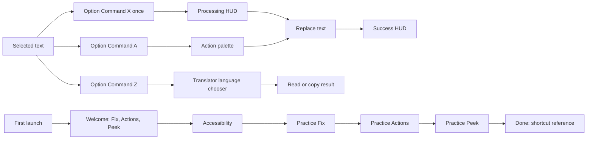

# hotkeygo Design Blueprint

**Status:** normative product and motion specification  
**Platform:** macOS 13+, menu bar utility  
**Implementation model:** SwiftUI views hosted in AppKit windows and panels  
**Canvas unit:** 1 point at native macOS scale  
**Source of truth:** the current hotkeygo implementation on `main`

This document is intended to be handed to a designer or engineer. Recreate the system precisely before proposing variations. Preserve the supplied brand assets and the distinct behavior of the Actions palette and dedicated Peek surface.

---

## 1. Product character

hotkeygo is a fast, keyboard first writing utility that lives beside selected text. It should feel like a small, alert cyber companion rather than a conventional AI chat product.

The visual character combines:

- pale paper like surfaces and near black ink;
- electric violet as the primary action color;
- cyan and magenta chromatic splits as the cyber signal;
- compact monospaced operational copy;
- rounded macOS geometry with thin borders;
- tiny expressive text faces that communicate state;
- motion that is brief, local, and tied to real activity.

### Design principles

1. **Selected text stays central.** Context panels sit beside the selection and avoid covering it.
2. **Keyboard use is visible and complete.** Every quick action can be reached with arrows, Tab, Return, Escape, or a number.
3. **Quick surfaces remain compact.** Feedback confirms. A palette chooses. Peek reads. None becomes a dashboard.
4. **Faces guide instead of decorate.** Use one small contextual face, never a large mascot illustration.
5. **Cyber effects carry meaning.** Scans mean processing, green means replacement succeeded, magenta and cyan distinguish modes.
6. **No invented chrome.** Do not add explanatory labels, helper rows, floating badges, or persistent copy to quick actions.
7. **Mouse and keyboard are equal input paths.** Every visible button must click; every core flow must work without a mouse.

### Nonnegotiable product rules

- The default hotkeys are Fix **Option + Command + X**, Actions **Option + Command + A**, and Peek **Option + Command + Z**. Settings lets the user record a unique key combination for each action. The shared close shortcut for interactive panels remains **Option + Command + X**. The menu-bar popover close badge follows the configured Fix shortcut.
- One press fixes and replaces selected text by default. An optional Preview & Approve mode can show the proposed result first and wait for explicit approval.
- The default **Option + Command + A** opens the action palette.
- The default **Option + Command + Z** opens Peek.
- The action palette and the focused translator are intentionally separate surfaces. Preserve their distinct behavior.
- Do not display an interruptive **29/30** notification. Limit interruption happens only when usage reaches **30/30**.
- Onboarding requests Accessibility access first, then teaches the real hotkeys through direct interaction.
- Onboarding can advance by mouse click or Return. Never present a Continue control that only looks clickable.
- Loading uses the exact “Look around” face sequence defined in this document.

### Product flow map



---

## 2. Brand assets

HotkeyGoUI is the implementation catalog for shared controls and semantic icons; see `docs/HOTKEYGO_UI.md`. Feature code must not choose a visual icon merely because an SF Symbol is convenient. The primary Fix, Review, Actions, Peek, Theme, Access, and Plan icons use a curated local vector family with soft, readable contours. Small platform/utility actions may use the explicitly catalogued system-symbol fallback; report an icon gap when no suitable asset exists.

Use the supplied lowercase outlined SVG wordmark `hotkeygo` where the product logo is needed. The menu-bar item uses the full wordmark at 48.16 × 12 pt, preserving its dark/light appearance variant and cyan/magenta key outline. The app icon keeps the standalone key artwork.

| Asset | Use |
|---|---|
| `HotkeyGoWordmark` | Outlined lowercase `hotkeygo` SVG, sized to its surface |
| `ToolbarWordmark` | Appearance-aware wordmark image for the menu bar, 48.16 × 12 pt |
| App icon set | macOS application icon at native sizes |

Keep the app icon on its standalone key artwork; do not retype the wordmark in a live font.

---

## 3. Color system

All semantic colors have explicit light and dark variants. Use sRGB values exactly.

| Token | Light | Dark | Role |
|---|---:|---:|---|
| `ink` | `#16131F` | `#F1EDFA` | Primary text, strong icons |
| `secondary` | `#6E6B7D` | `#B0ABBF` | Hints, metadata, inactive controls |
| `canvas` | `#F9F8FC` | `#0C0A12` | Main window background |
| `canvasRaised` | `#FDFCFF` | `#120F19` | Headers, footers, utility bands |
| `surface` | `#FFFFFF` | `#17141F` | Cards and panels |
| `surfaceHover` | `#F6F4FD` | `#251F30` | Hover, keycap, quiet selected areas |
| `line` | `#DCDBE2` | `#34323C` | Borders and dividers (neutral, no violet tint) |
| `tile` | `#EEE8FF` | `#241C38` | Selected radio tiles |
| `popupBorder` | `#D6D4DE` | `#34323C` | 360 pt Actions / Peek shell border |
| `popupDivider` | `#ECEBF0` | `#34323C` | Actions / Peek header, list, and footer dividers |
| `popupMuted` | `#9A97A8` | `#B0ABBF` | Popup source context, digits, and footer copy |
| `violet` | `#6D28FF` | `#9661FF` | Primary buttons and active focus |
| `hudTone` | `#7B5CF0` | `#A98BFF` | Processing HUD only: left accent bar and glow, face outline, `AI` badge |
| `magenta` | `#FF2D9B` | `#FF4FAD` | Panel output and chromatic split |
| `cyan` | `#00ABC7` | `#26C9E3` | Translation, cloud state, chromatic split |
| `success` | `#149145` | `#45C770` | Allowed and completed states |
| `terminalGreen` | `#0C7332` | `#47E67D` | Compact replacement success HUD; light value keeps microcopy legible |
| `warning` | `#D17308` | `#FAA629` | Missing access and caution |
| `danger` | `#E6293D` | `#FF5E6E` | Failure and destructive actions |
| `receipt` | `#F3F1F7` | `#1F1A27` | Quiet receipt or transcript surface |

### Color grammar

- Violet is the default interactive accent.
- Cyan owns translation and network/cloud cues.
- Magenta owns summary and panel style output.
- Green is reserved for completed or allowed states. In the Fix HUD, the green chip marks the completed request and posted paste.
- Warning and danger appear only when the user needs to act or an action failed.
- Cyan and magenta may appear together only for the chromatic face split, scan line, or processing sweep.
- Strong accent backgrounds use white foreground text.

### Theme behavior

The app defaults to Auto, following the current macOS appearance in SwiftUI and AppKit windows, including system appearance changes while the app is open. Users can instead choose an explicit Light or Dark appearance. Auto clears any per-window appearance override; do not derive the app theme from a translucent system material.

---

## 4. Typography

### Families

1. **Interface sans:** macOS system font.
2. **Operational mono:** macOS system monospaced font.
3. **Faces:** `JetBrains Mono ExtraBold`. Fall back to system monospaced Heavy.
4. **Large onboarding display:** system Rounded, Bold or Black.

### Type scale

| Style | Specification | Use |
|---|---|---|
| Display | 32 pt, Heavy, Rounded, tracking `-0.8` | Onboarding headline |
| Demo text | 21 pt, Semibold, Rounded | Selected onboarding sample |
| Card title | 16 pt, Bold, Sans | Access and limit cards |
| Reading body | 15 pt, Regular, line height about `22` | Peek translation content |
| Compact body | 13 pt, Regular or Semibold | Result cards, notices |
| Control title | 12 pt, Bold | Settings rows and buttons |
| Operational title | 11 pt, Bold Mono | HUD and compact modes |
| Control mono | 10 pt, Bold Mono | Actions, key hints, context |
| Popup mono | 11 pt, Medium Mono | Actions / Peek context and quiet footer |
| Label | 9 pt, Bold Mono, tracking `0.35` | Section labels and metadata |
| Micro status | 8 pt, Bold Mono, tracking `0.8–1.1` | HUD badges and detail |

- Use uppercase only for operational signals such as PROCESSING, READY, PASTE SENT, PASTE NOT SENT, AI, SENT, or ERR. Use sentence case for normal settings and explanations.

---

## 5. Geometry, spacing, and elevation

### Spacing rhythm

Use a 2 point base rhythm. Common values are `2, 4, 6, 8, 10, 12, 14, 16, 18, 24`.

### Corners

| Element | Radius |
|---|---:|
| Main context panel | 14 |
| Onboarding palette | 17 |
| Onboarding selection card | 16 |
| Standard card | 12 |
| Processing HUD | 11 |
| Compact control/button | 8 |
| Small chip | 5–7 |
| Capsule choice | Full capsule |

Rounded rectangles use continuous corners where available.

### Borders

- Standard panel: 1 pt `line`.
- Selected/focused control: 1 pt accent at 55–75% opacity.
- Onboarding sample card: 1.5 pt `line`.
- Context accent rail: 2 × 24 pt capsule, inset 1 pt from the left edge.
- Mode/action accent: 3 × 12–18 pt rounded bar.

### Shadows

- Standard card: `#16131F` at 6% light / black at 30% dark, blur 12, y offset 5. No violet-tinted shadows.
- Violet glow is allowed only on primary buttons, at most 16% light / 24% dark.
- Processing HUD: `#16131F` at 10%, blur 14, y offset 6 (light); black at 45%, blur 16, y offset 6 (dark).
- Use AppKit panel shadow for floating windows. Avoid stacking additional heavy shadows.
- Exception: the status chip (processing, success, error, offline) draws its own shadow. Processing and success use a clear 36 pt margin, disable the native shadow, and ignore mouse events so the HUD never blocks the active app. Error and offline keep an interactive close control; they use the compact panel bounds without a click-through shadow margin. A native shadow would trace the transparent panel rectangle as a visible plate.

### Standard surface recipe

```
fill: surface
corner radius: 14
border: 1 pt line
optional left accent: 2 × 24 capsule
```

---

## 6. Face system

Faces are text, always monospaced, kept on one line, and usually bracketed. They communicate current state and provide personality without adding a separate mascot panel.

| State | Face | Typical use |
|---|---|---|
| Hello | `[ ^_^ ]` | Ready, friendly neutral |
| Boot | `[ o_o ]` | First launch and permission |
| Ready | `[ ^_- ]` | Success and completed action |
| Pay | `[ ^o^ ]` | Usage limit and upgrade |
| Broke | `[ $_00_$ ]` | Out of tokens |
| Empty | `[ x_x ]` | 30/30 used |
| Upsell | `[ ¬_¬ ]` | Advanced plan prompt |
| Advanced | `[ ⌐■_■ ]` | Advanced plan active; more room to work. It stays visible without blinking to another expression. |
| Lost | `[ ?_? ]` | No network signal |
| Retry | `[ @_@ ]` | Reconnecting or retrying |
| Idle | `[ #_# ]` | Offline waiting |
| Scanning | animated, below | Active request |

### Face sizing

- Processing HUD: 13 pt.
- Menu and small status: 13 pt, using the cyan/magenta chromatic split.
- Peek inline states: 12–15 pt.
- Upgrade card: 14–16 pt.
- Onboarding guide: 12 pt inside a 58 × 36 container.
- Never enlarge faces into hero artwork. The brackets should remain crisp and the face should not pixelate.

### Chromatic split

At 13 pt and above, render cyan and magenta copies behind the main glyph:

- cyan x offset: `-1.5 × size / 18`;
- magenta x offset: `+1.5 × size / 18`;
- main glyph remains centered in `ink` or the specified foreground color.

Below 13 pt, show only the primary glyph.

### Normal blink

- Begin open.
- Remain open for 4030 ms.
- Show the closed face for 170 ms.
- Repeat.
- Optional stagger between multiple faces: `stagger index × 1130 ms`.
- Reduced Motion: remain open and static.

### Loading face: “Look around”

This is the only scanning sequence. Change the face text only; keep its container, label, colors, and layout fixed.

```text
[ ¬_¬ ]
[ ¬_¬ ]
[ ¬_¬ ]
[ •_• ]
[ ¬_¬ ]
[ ¬_¬ ]
[ ¬_¬ ]
[ ¬‿¬ ]
```

- Frame duration: **320 ms**.
- Loop duration: approximately **2.56 seconds**.
- Start on `[ ¬_¬ ]` to avoid a visual jump.
- Preserve every space and the fixed seven character width.
- Use a monospaced font so `_` and `‿` occupy the same width.
- Reduced Motion: static `[ ¬_¬ ]`.
- Stop and dispose of the timer/task as soon as the request finishes or the face changes.

---

## 7. Motion system

Motion must explain state, input, or spatial continuity. Never animate the entire interface continuously.

| Motion | Timing | Curve | Behavior |
|---|---:|---|---|
| Processing label glyph wave | 560 ms loop | quadratic ease in/out | Cyan/magenta energy crosses characters, then holds for final 25% |
| Processing progress trace | 460 ms loop | linear | 42 pt light trace crosses a 100 × 2 track |
| HUD border sweep | 640 ms loop | linear | 68 × 1 highlight travels from x `-68` to `224` |
| Success outline pulse | 720 ms | ease out | Scale `1 → 1.18`, opacity `1 → 0` |
| HUD phase change | 130 ms | snappy | Insert at 97% scale; remove toward 101.5% |
| Feedback panel entrance | 80 ms | AppKit default | Alpha `0 → 1` |
| Palette entrance | 140 ms | AppKit default | Alpha `0 → 1` |
| Peek entrance | 150 ms | AppKit default | Alpha `0 → 1` |
| Peek resize | 180 ms | ease out | Keep top edge fixed while height changes |
| Onboarding state change | 240 ms | snappy | Local opacity and 94% scale transitions |
| Onboarding key response | 160 ms | snappy | Key press/tap state |
| Onboarding typed result | 22 ms per 2 characters | linear | Begins after 900 ms processing |
| HotkeyGoUI primary button impulse | 200 ms | ease out | One cyan edge trace on press; never delays the action |
| Radio tile state change | 150 ms | ease out | Border, fill, and bevel change without moving the tile |
| Radio tile check key | ~220 ms | spring | Opacity and scale reveal the selected state |
| Radio tile glitch edge | 120 ms | stepped flicker | One selected silhouette flicker; none with Reduce Motion or Increase Contrast |
| HotkeyGoUI quiet control impulse | 160 ms | ease out | One short edge trace on toggle or other custom button press |
| HotkeyGoUI toggle thumb | 240 ms | ease out | Translate horizontally across a fixed track; never replace its layout position |
| Face blink | 4030 + 170 ms | stepped | Open pause, brief shut frame |
| Loading face | 320 ms/frame | stepped | Eight exact frames |

### Processing word effect

The word `PROCESSING` uses a character wave:

- 60 Hz timeline;
- 560 ms cycle;
- movement completes during the first 75% of the cycle;
- wave energy radius: 2.35 characters;
- cyan and magenta copies shift up to 1.8 pt left/right;
- glyph lift is up to 2.3 pt before the wave and 1.1 pt after it;
- maximum y axis rotation: 34° with perspective 0.48;
- static fallback: ordinary 11 pt Bold Mono, tracking 0.8.

### Reduced Motion

When macOS Reduce Motion is on, or when the app’s animation preference is off where supplied:

- scanning and blinking faces become static;
- processing word becomes static;
- progress trace and border sweep do not travel;
- success pulse is removed;
- control edge impulses are removed, as are pressed/hover scale and offset movement;
- state transitions do not scale or move;
- panel resize is immediate;
- panel entrances may use a short 80 ms opacity fade only;
- all controls, status changes, and completion messages remain available.

macOS Dim Flashing Lights also suppresses HotkeyGoUI control edge impulses without changing the control value.

---

## 8. Context panel behavior

Quick panels are borderless, nonactivating AppKit panels with transparent window backgrounds, native shadows, and SwiftUI content.

### Placement

- Screen edge inset: 12 pt.
- Gap from selected text: 14 pt.
- Prefer the right side of selection when it fits.
- Otherwise use the left side.
- If neither fits, dock to the farther visible screen edge based on selection center.
- Vertical connection point is `min(panel height / 2, 42)` from the panel top relationship.
- Clamp the entire panel to the visible frame.
- Use mouse location only when Accessibility selection bounds are unavailable.

### Window behavior

- Join all Spaces and appear over full screen applications.
- Quick panels do not become main application windows.
- Click outside closes an unpinned palette or Peek panel.
- Escape closes the current layer; where a nested step exists it goes back first.
- Interactive transient panels use the shared `⌥⌘X` dismissal path. Surfaces that show a close badge keep the cut-corner badge; the lighter Actions and Peek picker/result states omit it and close with Escape, outside click, or the global popup shortcut. The shortcut closes the frontmost visible popup before it can start Fix; it runs Fix with no popup only while Fix keeps its default `⌥⌘X` binding. The menu-bar popover also shows the configured Fix shortcut on its close badge and closes when that shortcut is pressed.
- Processing, retry, success, and short automatic notices remain click-through and do not show a close badge. Settings and Onboarding retain native macOS window closing; onboarding keeps its Fix practice shortcut.
- Restore focus to the originating application before changing selected text.
- Never repeatedly recreate/show a visible panel in response to its own state updates. Resize or replace content in place to prevent blinking.

---

## 9. Primary feedback HUD

The one press fix flow uses a compact processing/success/error HUD beside the selected text. Its position follows the captured selection (falling back to the pointer when bounds are unavailable) and is recomputed for each phase; review and other contextual panels remain beside selected text.

### Window and box

- Processing window: **216 × 50**. Fix completion window: **216 × 67** to fit the note tab on the box's top edge.
- Internal status box: **206 × 40** with 5 pt outer inset.
- Status box uses a 7 pt cut corner and 10 pt horizontal padding.
- Main HStack gap: 8.
- Face slot: 49 × 25; outline: 47 × 23 with a 5 pt cut corner.
- Left accent: 2 × 24 with 5 pt glow.

### Surface

- Light: `#FAFAFC` at 98%.
- Dark: `#121116` at 96%.
- Add a 135° wash: lilac (`#8F6BFF` at 5% light / `#A98BFF` at 8% dark) → clear.
- Border: `line` in light mode, white at 7% in dark mode.
- Cyan/magenta offset edges: 58% light, 38% dark.
- Apply the Processing HUD shadow defined in the elevation section.

### Processing state

- Face: animated scanning face at 13 pt.
- Headline: cyan `>` plus animated `PROCESSING`.
- Badge: `AI` in `hudTone`.
- Progress track: 100 × 2, base `line`, 42 pt violet/magenta/cyan moving trace.
- Border sweep runs while processing.

### Fix completion state

- Face: [ ^_- ].
- Headline: SUCCESS in `terminalGreen`.
- Detail: RESULT READY in 8 pt mono.
- Badge: OK.
- The Fix result stays on the system clipboard after the automatic paste attempt.
- Success marks a completed Fix request and posted paste event; it does not prove that the editor accepted the paste. If the result is missing, the user can press ⌘V.
- Default one press duration: 1.25 seconds.

### Paste error state

- Face: [ @_@ ].
- Tone: danger.
- Badge: ERR.
- Headline: PASTE NOT SENT.
- Detail: explain that the fresh text is ready to copy and tell the user how to continue.
- Include the shared Option Command X close badge. Typical duration: 4 seconds, or until explicitly dismissed when the error is shown by Actions.

### Other compact notices

No selection and subscription sync use a standard compact notice:

- HStack gap 11, horizontal padding 13, vertical padding 11;
- panel radius 13 with contextual 2 × 24 accent;
- icon tile 32 × 32, radius 9;
- title 13 Semibold; detail 10.5 Regular;
- window sizes: no selection 306 × 82, subscription 326 × 86.

No selection hides after 2.4 seconds. Ordinary errors hide after 4 seconds. Offline uses the cyber status chip with `CONNECTION LOST`, concise unchanged text, a `NET` badge, and the shared `⌥⌘X` close control. Limit states may remain until explicitly dismissed or superseded in the one press flow.

### Accessibility access notice

Show a dedicated access notice when a Fix, Actions, or Peek shortcut is pressed while `AXIsProcessTrusted()` is false. Use one reusable non-activating `NSPanel` at `.statusBar` level, 372 × 62 pt, centered at the top of the screen under the menu bar with a 12 pt gap. Repeated shortcuts restart the same notice timer. Never show an access notice after permission is granted.

- The plate is always `#14111C`, independent of system appearance. Its 1.5 pt border is made from an outer cut-corner gradient fill and an inset fill; outer/inner cuts are 12/11.4 pt. The gradient runs from warning at 70% to violet at 60%, increasing to 100%/70% on hover.
- Place the 11 pt blinking `[ o_o ]` brand face at the left, colored `#FAA629`, with 1 pt cyan/magenta split edges and no backing tile. Reduce Motion keeps the face still.
- Use the single-line title “Accessibility access needed” in 13.5/17 pt SF Pro 800 and the detail “Privacy & Security › Accessibility” in 10.5/14 pt JetBrains Mono 500. Use `#F1EDFA` and `#B0ABBF` respectively.
- The trailing OPEN ↗ key is 30 pt high with a warning border, 7/6.4 pt cuts, and a 1.5 pt inset. Its idle fill is warning at 16% over the plate; hover fills it with warning and moves the arrow 1.5 pt up/right. Hovering anywhere on the plate uses the hover border and button state.
- Add a 2 pt warning accent inset 16 pt from the top and bottom, a 30 × 1.5 pt top tick at x=20, cyan/magenta edge shadows, and a black 0/10/22 shadow at 45%.
- A 1.5 pt countdown line sits on the bottom edge from x=18 to 12 pt before the right edge. It shrinks linearly over 8 seconds (configurable from 5–10); hovering freezes the remaining time and mouse-out resumes it without a jump.
- Appear/disappear with 250 ms ease-out opacity and a 6 pt vertical move. Reduce Motion fades without moving; the countdown continues. Pressing moves the plate down 1 pt. Escape does nothing.
- The entire plate is one button. Each explicit click while access is missing requests Accessibility permission and opens `x-apple.systempreferences:com.apple.preference.security?Privacy_Accessibility`; the notice dismisses immediately. Post a VoiceOver announcement when it appears; the button label is “Accessibility access needed. Open System Settings.”
- Keep the panel non-activating and do not create waiting or granted variants.

## 9.1 Fix preview panel

When Preview & Approve is enabled, the processing HUD transitions to an interactive preview panel without changing the source selection.

- The panel is a non-activating keyboard-capable surface anchored beside the selection, with the shared `⌥⌘X` close badge.
- Show `FIX · PREVIEW` and `TEXT UNCHANGED` in the header.
- Present one selectable, scrollable suggested-text view with additions and removals inline; expose the untouched original through a small `Show original` toggle instead of showing two full blocks at once.
- Highlight additions and removals with both color and text decoration; never rely on color alone.
- `Return` approves the suggestion. `Esc`, Keep original, or clicking outside dismisses it without changing the source.
- Approval restores the captured focus and runs the same Accessibility/clipboard replacement path as the default Fix flow; it reports an error only when that replacement operation fails.
- The original and suggested text are transient and must never be persisted or logged.

### Limit card

- Window: **420 × 232**.
- Header: 42 pt with the hotkeygo lockup, feature name, and its shortcut badge.
- Usage strip: 40 pt with `[ x_x ]`, `30 / 30 used`, and `0 free left`.
- Body title: `30/30. You ran it dry.` at 20 pt Rounded Black.
- Body copy explains that Advanced gives more room to work with the same quality bar.
- Action row uses a full-width `Get Advanced · $10` primary button and a `Nah` subtle dismissal button.
- Panel radius: 14 with the established violet/cyan/magenta edge treatment.
- Copy communicates that 30 free actions are used. There is no 29/30 interruption.

---

## 10. Action palette: Option + Command + A

This surface is a compact one-column chooser. The active action uses the same dark button language as Settings; every other row stays plain text so the current choice is the only strong shape.

### Window

- Width: **360 pt**; height follows the visible rows.
- Outer shell: 1 pt `#D6D4DE` border in Light, adaptive dark line in Dark; 12 pt cuts at top-left and bottom-right.
- Entrance: 140 ms alpha fade; 80 ms with Reduce Motion.
- Header: 48 pt, horizontal padding 16, bottom divider `#ECEBF0` in Light and adaptive line in Dark.
- Footer: 32 pt with the same divider and horizontal padding.
- List padding: 10 pt; row gap: 6 pt; maximum content height 380.

### Header

- No logo or close badge.
- Violet caret and `Search…` field on the left.
- Trailing context: the detected source language as a full name and the selected-text word count, for example `Indonesian · 9 words`, in 11 pt Mono Medium.
- No language codes, explanatory paragraph, or shortcut legend.

### Action rows

- One column. Translation targets appear first, followed by a 1 pt divider inset 4 pt, then rewrite actions. No section labels.
- Row height: 41 pt. Labels are 14 pt system Bold; right-side digits are 12 pt Mono Bold.
- The selected row is the only shape: 38 pt inner height plus 1.5 pt gradient edge (`#00ABC7 → #6D28FF → #6D28FF → #FF2D9B`, 100°), 8 pt cut corners, `#16131F` fill, and a 16 × 1.5 pt white highlight at x 10 / y 4. In Dark, use the existing dark Settings button fill and adaptive HotkeyGoUI colors.
- Unselected rows have no border or fill at rest; hover uses a quiet inset wash (`#F6F4FD` in Light, the existing dark surface-hover token) with 6 pt cut corners and 6 / 3 pt horizontal / vertical insets.
- Selected row shows `↵`; other rows show plain digits. No boxed keycaps, subtitles, or per-action colors.
- No leading icon or face. Keep the text edge aligned and let the title carry recognition.

### Actions

1–2. **Translate** — one row per useful target language; replaces selection.
Then a divider, followed by **Slack style** and **Make formal**; both replace selection.
- The last-used supported choice is preselected and appears first within its section.
- Typing filters visible language names and action names. If an Actions search has no matches, show "No matching action"; Return does nothing. Actions never sends typed text to the model as an instruction.
- Footer: `Replaces selection · ⌘Z undo`.

Actions has no quick-questions step and no panel output. Every preset (translate, Slack style, make formal) replaces the selection; its prompt lives in the Worker. A selection over 2 pages (6 000 characters) shows the `TOO LONG` error chip instead of opening the palette.

### Keyboard map

| Key | Action |
|---|---|
| Up / Down | Move selection |
| Tab / Shift Tab | Move forward/back |
| Return | Run selected action |
| 1–4 | Run corresponding visible row when query is empty |
| Escape | Close |
| Command Z | Undo the latest text replacement |

Mouse clicking a row performs the same action as Return. Clicking outside closes the palette.

---

## 11. Translator: Option + Command + Z

Option + Command + Z is a dedicated read-only translator. It never replaces the selected text. Its only jobs are choosing a language, presenting a highly readable translation, pinning it, and copying it. Summary does not live in this flow.

### Window sizes

| State | Size |
|---|---:|
| Four-row chooser | 360 × 286 |
| Loading or success | 360 × 150 |
| Loaded | 360 pt wide, height follows the result up to 360 pt |
| Pinned | 360 × 560 |
| Limit | 360 × 300 |
| Failure | 360 × 165 without a selection, otherwise 360 × 200 |

- Entrance: 150 ms alpha fade; 80 ms with Reduce Motion.
- State resize: 180 ms ease out with the top edge fixed.
- Pinned position: 16 pt from right edge and 56 pt from top visible edge.
- Unpinned Peek closes on outside click. Drag the Peek title or the empty result-header space after the target language to move the panel in either pinned or unpinned mode; dragging never activates a main app window.

### Header

- Pick header: 48 pt, with a 72 pt `Peek` title drag area at the left, no logo or close badge. Violet caret and `Search…` field follow the title; full source language and word count (for example `Indonesian · 9 words`) appear on the right.
- Result header: the same `Peek` title drag area, full source language and arrow, the selected target as a small dark button, empty drag space, and a close button on the right. No language codes.

### Initial chooser

- Use a single column, 10 pt padding, 6 pt row gaps, and 41 pt rows.
- Language names only; no codes, English-description subtitles, or `last used` suffix.
- The remembered target appears first and is preselected. Search filters by the visible name and its full English name.
- Use the same selected dark row and plain digits as Actions. Clicking a row or pressing 1–4 starts translation immediately.
- No-match search shows a quiet `No language matches` row.
- Footer: `Preview only · nothing is replaced`.

### Translation result

- There is no secondary control strip; the result begins directly below the header.
- Translation body: 15 pt Regular Sans with 22 pt line spacing.
- Body padding: 14 pt top, 16 pt horizontal, 16 pt bottom.
- Loaded body maximum height: 250 unpinned, 500 pinned.
- Tab runs the next language in place; Shift-Tab runs the previous one. Return and Command-C copy the translation. The footer line is clickable for mouse copy.

### Markdown reading format

Translation results use a compact Markdown renderer:

- paragraph gap: 8 pt;
- headings: 14.5 / 13.5 / 12.5 pt Bold for levels 1 / 2 / 3+;
- unordered list marker: a quiet en dash;
- numbered list marker: 11.5 pt Bold Mono in the mode color;
- quotes: 2 pt mode-color rail and secondary text;
- fenced code: minimum 10.5 pt Medium Mono on the `receipt` surface, radius 8, 10 × 8 pt padding, horizontal scrolling;
- inline Markdown supports emphasis, strong text, links, and code spans;
- all rendered result text remains selectable.

The translation request returns `{ "paragraphs": [string] }`: one item per paragraph of the input, in order, with each list, code block, or heading as its own item. It never repeats the original text, so output stays roughly the size of the translation alone. It adds no titles or section labels. Preserve headings, lists, quotes, fenced code, existing Markdown, file names, line references, commands, and code identifiers. Do not add commentary. Empty items are dropped; the copy action joins paragraphs with blank lines.

### Loading and state content

- Loading reuses the standard compact cyber status chip with the scanning face, animated `PROCESSING` label, moving trace, and `AI` badge.
- As soon as the translation is ready, show it in the same panel. The processing chip remains for the active request and respects Reduce Motion.
- No selection, offline, and request failures show the existing error/status chip inside Peek's body. The embedded chip fills the available width; Escape and the global popup shortcut still close the panel. No selection keeps the panel compact; recoverable failures retain Retry.
- Limit uses `[ ^o^ ]` at 14 pt and a compact upgrade button.
- Offline uses `[ ?_? ]` or `[ #_# ]` with concise unchanged text.

### Footer

- Height: 32 pt with a quiet 11 pt Mono Medium line.
- Pick: `Preview only · nothing is replaced`.
- Result: `↵ copy · Esc close`; click the line to copy. Command-C remains available. Pin/Unpin remains on `P` and in the header context menu.

### Keyboard map

| Context | Key | Action |
|---|---|---|
| Chooser | Up / Down or Tab | Move choice |
| Chooser | Return | Submit choice |
| Chooser | 1–4 | Translate to numbered language |
| Result | Tab / Shift-Tab | Run the next / previous language in place |
| Result | Return | Copy translation |
| Result | 1–4 | Translate to the numbered language |
| Any | P | Pin or unpin |
| Loaded | Command C | Copy result |
| Any | Escape | Close |

Language rows, `⇥ next`, the copy footer, Pin, and Close remain reachable with mouse or keyboard.

---

## 12. Onboarding

Onboarding is a real interactive rehearsal, not a slideshow.

### Window and structure

- Window: **820 × 640**.
- Standard titled, closable macOS window with transparent title bar.
- Header: 52 pt, horizontal padding 42 leading and 22 trailing.
- hotkeygo wordmark: 120 × 46.
- On Welcome, the center visual is a large `[ ^_- ]` face. The wink is magenta; the rest uses the theme's ink color.
- Main title: 32 pt Heavy Rounded.
- Footer: 60 pt, horizontal padding 20, top divider.
- Steps: **Welcome → Access → Fix → Actions → Peek → Done**. Completed steps remain clickable for returning to earlier instructions.
- Done-step menu-bar callout: use an `ink` capsule with `surface`-colored Wi-Fi, the `hotkeygo` wordmark, and time so the foreground stays legible in both themes.

### Welcome

- State the core workflow briefly and show all three feature shortcuts in one compact list.
- Keep Fix first and describe it as the smallest safe correction in place. Describe Actions as an explicit transformation and Peek as a read-only way to understand selected text.
- Use the current configured shortcuts rather than hard-coded defaults.

### Step 1: Accessibility access

- Ask for access immediately.
- `Allow access` opens the Accessibility pane in System Settings and begins permission polling.
- Show the System Settings path while waiting. Poll every 500 ms for up to 15 seconds, and check again when the app becomes active.
- When permission becomes granted, keep the user on this step and show the granted state with `ACCESS GRANTED · PRESS ENTER TO CONTINUE`. The footer button and Return both advance to Fix; permission detection never changes steps by itself.
- If access is still missing after 15 seconds, explain that it was not detected and provide a retry. `Do this later` remains available during the permission flow.

Guide copy must clearly say `PRESS ENTER TO CONTINUE` whenever Return advances the flow.

### Step 2: Press once

- Headline: `Fix it with one shortcut.`
- Selected sample: `helo i thnik this sentnce sound wierd`.
- User must press the currently configured Fix shortcut (Option + Command + X by default).
- Show the actual processing HUD, then type the corrected result:
  `Hello, I think this sentence sounds weird.`
- After completion, the visible Continue button and Return both advance.

### Step 3: Actions

- Selected sample: `yo can u send me the file asap pls`.
- User presses the currently configured Actions shortcut (Option + Command + A by default) once.
- Open the onboarding palette immediately.
- The palette is **360 pt wide**, uses the same single-column rows as the live Actions surface, and sizes to fit every visible choice.
- Choices: two useful translation targets, Slack style, and Make formal.
- Arrow keys move selection; Return chooses; 1–4 chooses directly; Escape closes.
- Use a local sample rehearsal with no network request; after a choice, show processing and type the result into the mock app.
- After completion, Continue or Return advances to Peek.

### Step 4: Peek

- Selected sample: `¿Nos vemos frente a la estación sobre el mediodía?`.
- User presses the currently configured Peek shortcut (Option + Command + Z by default) once.
- The shortcut opens the same four-language chooser as product Peek: Search, `Spanish · 9 words`, one row per language, and `Preview only · nothing is replaced` in the footer. Up / Down or Tab moves the selection, Return chooses, and 1–4 selects a numbered language.
- After a language is chosen, keep the chooser selection visible in the result header, show the standard processing status chip, then show the local sample translation in that panel. The header can switch to the next language; Tab / Shift-Tab and 1–4 also change the target and rerun the short loading state.
- Keep the source text selected in the mock app. This is a local demonstration fixture; it sends no request and never replaces the sample. The result footer copies the translation on click or Return and shows `Esc close`; Command-C also copies.
- Escape closes the chooser or result, including while the sample is loading. Continue advances after the translation appears.

### Done

- List the currently configured Fix, Actions, and Peek shortcuts.
- Explain that hotkeygo lives in the menu bar and can be opened there later.
- `Start using HotkeyGo` and Return both complete onboarding.

### Practice stage

- Keep the instruction rail at the left and a mock macOS app in the right stage.
- Show selected sample text with a pale violet highlight until Fix or Actions replaces it. Peek keeps the original selected while its preview is open.
- Demo text: 21 pt Semibold Rounded, with 7 pt inset padding.
- The Actions rehearsal embeds the live 360 pt palette and uses the same measured height as the product palette, so every choice remains visible.
- Use the actual compact processing and success HUD during Fix and Actions rehearsal.

### Guide face

- Face size: 13.
- Container: 54 × 34, radius 10, violet fill at 9%.
- Guide copy: 13.5 pt Medium in the footer, with one line of step-specific instruction.
- Keep the face small and context dependent.

### Hotkey rehearsal animation

The animated key diagram demonstrates the expected rhythm while waiting for real input:

1. idle for 850 ms;
2. Show the configured modifiers down for 220 ms;
3. Show the configured Fix, Actions, or Peek key down for 150 ms;
4. return to the held modifiers for 140 ms;
5. reset and wait 900 ms before repeating.

Key press state changes use a 160 ms snappy transition. Stop the demonstration when real user input starts.

### Result rehearsal timing

- Processing state: 900 ms.
- Type two characters every 22 ms.
- After typing completes, switch to complete state and reveal the continuation path.
- State transitions: 240 ms snappy opacity and 94% scale.

---

## 13. Settings window

### Window

- Production: **500 × 624**.
- Debug: **500 × 704**.
- Transparent full size title bar, movable by background.
- Canvas background, explicit theme.

### Layout

- Header: 72 pt, horizontal padding 18, `canvasRaised`.
- Lockup: 104 × 28.
- Subtitle: 10 pt Sans.
- Scroll content padding: 18; section gap: 14.
- Footer: 54 pt, horizontal padding 18, `canvasRaised`.
- Footer Quit uses the shared red cut-corner button with a power icon in both themes.

### Sections

- Appearance.
- AI model.
- Hot keys.
- Access.
- Plan / billing.
- Developer tools in debug builds only.

Each section uses a 9 pt Bold Mono label and a standard card. Setting rows have a minimum height of 54 and horizontal padding 12. Icon tile is 30 × 30, radius 8. Row title is 12 Bold; detail is 9.5 Regular with at most two lines.
The Plan card keeps its current row and copy, then adds the shared three-segment meter, `FREE` / `ADVANCED` labels, and a monthly usage/reset line. Free shows `used / 30 this month · resets {MMM d}`; the limit state uses red. Advanced uses three green segments and shows its renewal date. Hide the upgrade button for Advanced; show a Manage link only when billing management exists.

### Standard controls

- Standard primary button: 32 pt high, radius 8, 15 pt horizontal padding, 12 Bold white text, vertical violet gradient from `violet` to `#5716E0`, white border at 18%. Compact filled primary buttons are 30 pt high with 12 pt horizontal padding and the cyan-violet-magenta cut-corner border used by the menu plan CTA.
- Pressed primary state: opacity 82%, scale 98.5%.
- Subtle button: 30 pt high, radius 8, 12 pt horizontal padding, surface fill and line border.
- Shortcut badge: 25 pt high, radius 7, 7 pt horizontal padding, 10.5 Bold Mono.
- In Hot keys, each shortcut badge is a button. Click it, press a modifier-plus-key combination, and press Escape to cancel; show a Default button only for a changed binding. Explain duplicate or popup-reserved combinations in the row detail.
- Keycap: minimum 26 × 25, radius 6, bottom key edge line.
- Access badge: capsule, 28 pt high or 24 pt compact, success/warning tone.
- Toggle: use the custom angular `ON` / `OFF` control; its visible label is optional when the parent row already provides the setting name, but its accessibility label remains required.
- Theme selector: use a three-column radio-tile grid with fixed-color mini window previews for Auto/Light/Dark. Auto follows the system appearance; Light and Dark are explicit overrides.
- AI model selector: use full-width radio-tile rows with a provider logo, model name, provider name, and selected check key.
- Radio tiles: use one shared `HotkeyGoUI.RadioTileGroup` with `.grid(columns:)` or `.list` layouts. The cut-corner border stays 1.5 pt in every state; selection uses a violet bevel and check key without a circular indicator or layout shift. Arrow keys move and select; Space and Return activate the focused tile.

---

## 14. Menu bar popover

- Width: **360**.
- Background: `canvas`.
- Wrapper: `HotkeyGoControlShape` with a 16 pt chamfer on the top-left and bottom-right corners, plus a 1 pt `line` stroke; do not use a rounded outer container.
- AppKit host: borderless, nonactivating panel with a native shadow; do not expose the system popover bubble or chevron.
- Utility bar: 26 pt, horizontal padding 12, version left and inline accessibility status on the right. Show `Access Needed` with a warning-yellow dot or `Access` with a green dot. Do not show an environment label or dropdown until another environment is available.
- Plan row: 66 pt high in every state, padding 0 12 0 20, gap 14. Show `[ ^_^ ]` for Free and `[ ⌐■_■ ]` for Advanced at 14.45 pt JetBrains Mono ExtraBold with the 1.275 pt cyan/magenta split. Free face is static and ink; Advanced is green with a soft dark-theme glow. Pair a 15 pt plan name and the shared meter with an 11 pt Mono subline. Free shows `used / 30 used`; at 30 it shows `Resets {MMM d}` in red and `Get Advanced`. Advanced shows `more room to work` and three green meter segments without a numeric usage subline. The close chip remains in the plan row's right slot. Advanced has no green row fill.
- A 30-tick line replaces the divider in the plan row. It spans x20 to the right 12 pt inset; Free used ticks follow the same ink/orange/red meter tone. Advanced shows all 30 ticks in green as a plan indicator, independent of usage. The limit row is clickable and tinted red at 5% light / 7% dark, with a stronger hover tint. Both the row and the CTA open checkout and close the popover; the popup dismissal shortcut still works.
- Menu and Settings use one live `PlanStatus`. Free usage counts every successful Fix, Action, and Peek; failed or cancelled requests do not count. Reset and renewal dates come from billing status. The meter boundaries are 1 ink at 0–10, 2 orange at 11–20, 3 orange at 21–29, 3 red at 30, and 3 green for Advanced.
- Show a compact `Preview & Approve` switch below the status row, bound to the same preference as Settings. Include a one-line status hint that nothing changes until approval.
- Bottom actions: two rows with 30 pt buttons and 8 pt gaps. Settings and Quit share the upper row at 50% width each; Onboarding spans the full width below. Use 12 pt horizontal and 9 pt vertical outer padding. Settings and Onboarding use the filled shared `PrimaryButton` style. Quit uses the soft shared `QuitButton` style with a light danger tint and warm-to-pink border. Compact primary and Quit buttons use 12 pt horizontal padding. The Settings footer uses the same soft Quit style.
- The four sections are the utility strip, status row, review row, and actions row, separated by single horizontal dividers.

Usage may be shown here as persistent plan information. It must not generate a separate 29/30 notification. At 30/30, show the upgrade action.

---

## 15. Content and copy rules

- Write short, direct, calm sentences.
- Operational UI may be terse: `READY`, `AI`, `OK`, `ERR`, `Esc`, `Copy ⌘C`.
- Explanations use normal sentence case.
- Fix may show SUCCESS after hotkeygo prepares the result and posts Command V; it does not claim the target editor accepted the text.
- Avoid generic AI language such as “magic,” “assistant is thinking,” or long model explanations.
- Keep technical implementation details out of product copy.
- Error titles explain the outcome; the detail explains the recovery action.
- Never place design system annotations such as `2A`, internal component names, or redline labels in production UI.

---

## 16. Accessibility and input

- Every icon-only control has an accessibility label.
- Face text exposes a useful state label such as `Scanning` rather than each animation frame.
- Combine multi-part badges into one accessibility element.
- Text remains legible in both themes and does not rely on accent alone.
- Interactive targets remain clickable across their full visible bounds.
- Visible Continue controls are real buttons.
- Return and keypad Enter share behavior.
- Escape consistently dismisses or goes back.
- Preserve text selection and VoiceOver access in result bodies.
- Respect macOS Reduce Motion throughout.
- Do not steal main-window status from the user’s active app for transient operations.

---

## 17. State and acceptance checklist

### Visual

- [ ] No product surface shows the former symbol mark; name surfaces use text-only `hotkeygo`.
- [ ] All colors come from semantic tokens.
- [ ] Actions and Peek use 360 pt width, the 12 pt cut-corner shell, and the correct adaptive colors.
- [ ] Faces use JetBrains Mono ExtraBold or the heavy monospaced fallback.
- [ ] Faces stay small and sharp; spacing inside brackets never shifts.
- [ ] Cyan/magenta splits appear only in approved cyber effects.
- [ ] No internal design labels are visible.

### Interaction

- [ ] One press fixes selected text and shows the processing HUD.
- [ ] The configured Actions shortcut (Option + Command + A by default) opens the one-column Actions list.
- [ ] The configured Peek shortcut (Option + Command + Z by default) opens the four-language Peek chooser.
- [ ] Arrow keys, Tab, Return, Escape, number keys, and result-language cycling work as specified.
- [ ] Every visible action also responds to a mouse click.
- [ ] Context panels do not cover the selected text when an adjacent position exists.
- [ ] Panels do not blink, reopen, or loop their entrance animation during state updates.

### Onboarding

- [ ] Accessibility access is requested in the first step.
- [ ] The Allow control opens the correct System Settings pane.
- [ ] Permission polling updates the same step to a granted state without advancing automatically.
- [ ] The user can choose `Do this later` while permission is missing.
- [ ] `PRESS ENTER TO CONTINUE` appears when Return can advance.
- [ ] Continue buttons click and Return produces the same result.
- [ ] The Welcome and Done steps show the configured Fix, Actions, and Peek shortcuts.
- [ ] The user can rehearse Fix and Actions through the real configured shortcuts and choose an action with the same palette used in the product.
- [ ] The user can rehearse Peek through its configured shortcut: choose a language, see processing, then read and copy the local translation while the original sample remains unchanged.

### Motion

- [ ] Loading uses the exact eight frame 320 ms sequence.
- [ ] The loading task stops immediately on completion.
- [ ] HUD trace, border sweep, label wave, and success pulse match exact timings.
- [ ] Panel entrance animation plays once per opening.
- [ ] Reduce Motion produces a complete, static experience.

### Usage

- [ ] No interruptive 29/30 notification exists.
- [ ] 30/30 displays the limit card and upgrade action.
- [ ] Persistent plan status may report ordinary usage inside Settings or the menu bar.

---

## 18. Design handoff prompt

Paste the following together with this document:

> Design hotkeygo for macOS from the attached normative blueprint. Reproduce its tokens, fixed window sizes, keyboard behavior, state hierarchy, face system, and motion timings exactly. Use the supplied hotkeygo assets without redrawing them. Treat the default Option-Command-X Fix flow, default Option-Command-A action palette, default Option-Command-Z Peek surface, onboarding, Settings, and menu bar popover as one coherent system. Settings can remap all three feature shortcuts; Option-Command-X stays reserved for popup dismissal, and the menu-bar popover close badge follows the configured Fix shortcut. Keep quick actions clear and keyboard first. Do not add generic AI chat patterns, large mascot art, glassmorphism, new gradients, new actions, or internal design annotations. Provide light and dark variants, all loading/success/error/limit states, and static Reduced Motion variants. Show interaction specifications for mouse, arrows, Tab, Return, Escape, and number keys. Validate every screen against the acceptance checklist before presenting it.

---

## 19. Implementation references

These files are the final authority if a numeric or behavioral ambiguity remains:

- `HotkeyGo/Core/DesignSystem/DesignSystem.swift`
- `HotkeyGo/Features/QuickImprove/Presentation/FeedbackPill.swift`
- `HotkeyGo/Features/QuickImprove/Presentation/FeedbackWindowController.swift`
- `HotkeyGo/Features/Palette/Presentation/PaletteView.swift`
- `HotkeyGo/Features/Palette/Presentation/PalettePanelController.swift`
- `HotkeyGo/Features/Palette/Presentation/ResultHUDController.swift`
- `HotkeyGo/Features/Peek/Presentation/PeekView.swift`
- `HotkeyGo/Features/Peek/Presentation/PeekPanelController.swift`
- `HotkeyGo/Features/Onboarding/Presentation/OnboardingView.swift`
- `HotkeyGo/Features/Settings/Presentation/SettingsView.swift`
- `HotkeyGo/Features/Settings/Presentation/MenuBarView.swift`
- `HotkeyGo/App/HotkeyGoApp.swift`
