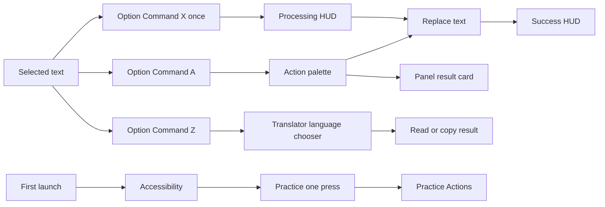

# Qwixit Design Blueprint

**Status:** normative product and motion specification  
**Platform:** macOS 14+, menu bar utility  
**Implementation model:** SwiftUI views hosted in AppKit windows and panels  
**Canvas unit:** 1 point at native macOS scale  
**Source of truth:** the current Qwixit implementation on `main`

This document is intended to be handed to a designer or engineer. Recreate the system precisely before proposing variations. Preserve the supplied brand assets and the distinct behavior of the Actions palette and dedicated Peek surface.

---

## 1. Product character

Qwixit is a fast, keyboard first writing utility that lives beside selected text. It should feel like a small, alert cyber companion rather than a conventional AI chat product.

The visual character combines:

- pale paper like surfaces and near black ink;
- electric violet as the primary action color;
- cyan and magenta chromatic splits as the cyber signal;
- compact monospaced operational copy;
- rounded macOS geometry with thin borders;
- tiny expressive text faces that communicate state;
- motion that is brief, local, and tied to real activity.

### Design principles

1. **Selected text stays central.** Context panels sit beside the selection and avoid covering it.
2. **Keyboard use is visible and complete.** Every quick action can be reached with arrows, Tab, Return, Escape, or a number.
3. **Quick surfaces remain compact.** Feedback confirms. A palette chooses. Peek reads. None becomes a dashboard.
4. **Faces guide instead of decorate.** Use one small contextual face, never a large mascot illustration.
5. **Cyber effects carry meaning.** Scans mean processing, green means replacement succeeded, magenta and cyan distinguish modes.
6. **No invented chrome.** Do not add explanatory labels, helper rows, floating badges, or persistent copy to quick actions.
7. **Mouse and keyboard are equal input paths.** Every visible button must click; every core flow must work without a mouse.

### Nonnegotiable product rules

- The main hotkey is **Option + Command + X**.
- One press fixes and replaces selected text by default. An optional Preview & Approve mode can show the proposed result first and wait for explicit approval.
- **Option + Command + A** opens the action palette.
- **Option + Command + Z** opens Peek.
- The action palette and the focused translator are intentionally separate surfaces. Preserve their distinct behavior.
- Do not display an interruptive **29/30** notification. Limit interruption happens only when usage reaches **30/30**.
- Onboarding requests Accessibility access first, then teaches the real hotkeys through direct interaction.
- Onboarding can advance by mouse click or Return. Never present a Continue control that only looks clickable.
- Loading uses the exact “Look around” face sequence defined in this document.

### Product flow map



---

## 2. Brand assets

TokiriUI is the implementation catalog for shared controls and semantic icons; see `docs/TOKIRI_UI.md`. Feature code must not choose a visual icon merely because an SF Symbol is convenient. The primary Fix, Review, Actions, Peek, Theme, Access, and Plan icons use a curated local vector family with soft, readable contours. Small platform/utility actions may use the explicitly catalogued system-symbol fallback; report an icon gap when no suitable asset exists.

Use the supplied assets. Do not redraw, typeset, trace, or approximate the logo.

| Asset | Use |
|---|---|
| `QwixitLockupLight` | Full wordmark on light surfaces |
| `QwixitLockupDark` | Full wordmark on dark surfaces |
| `QwixitMarkLight` | Small mark on light themed windows |
| `QwixitMarkDark` | Small mark on dark themed windows |
| `QwixitMarkInk` | Single color mark |
| `QwixitMarkWhite` | Mark on strong dark or color fills |
| `QwixitTower` / `QwixitTowerWhite` | Branded tower artwork where already specified |
| App icon set | macOS application icon at native sizes |

Logo and mark images use aspect fit. They must remain sharp at native Retina scale. Never render a logo bitmap larger than its intended asset resolution.

---

## 3. Color system

All semantic colors have explicit light and dark variants. Use sRGB values exactly.

| Token | Light | Dark | Role |
|---|---:|---:|---|
| `ink` | `#16131F` | `#F1EDFA` | Primary text, strong icons |
| `secondary` | `#6E6B7D` | `#B0ABBF` | Hints, metadata, inactive controls |
| `canvas` | `#F9F8FC` | `#0C0A12` | Main window background |
| `canvasRaised` | `#FDFCFF` | `#120F19` | Headers, footers, utility bands |
| `surface` | `#FFFFFF` | `#17141F` | Cards and panels |
| `surfaceHover` | `#F6F4FD` | `#251F30` | Hover, keycap, quiet selected areas |
| `line` | `#DCDBE2` | `#34323C` | Borders and dividers (neutral, no violet tint) |
| `violet` | `#6D28FF` | `#9661FF` | Primary buttons and active focus |
| `hudTone` | `#7B5CF0` | `#A98BFF` | Processing HUD only: left accent bar and glow, face outline, `AI` badge |
| `magenta` | `#FF2D9B` | `#FF4FAD` | Panel output and chromatic split |
| `cyan` | `#00ABC7` | `#26C9E3` | Translation, cloud state, chromatic split |
| `success` | `#149145` | `#45C770` | Allowed and completed states |
| `terminalGreen` | `#0C7332` | `#47E67D` | Compact replacement success HUD; light value keeps microcopy legible |
| `warning` | `#D17308` | `#FAA629` | Missing access and caution |
| `danger` | `#E6293D` | `#FF5E6E` | Failure and destructive actions |
| `receipt` | `#F3F1F7` | `#1F1A27` | Quiet receipt or transcript surface |

### Color grammar

- Violet is the default interactive accent.
- Cyan owns translation and network/cloud cues.
- Magenta owns summary and panel style output.
- Green is reserved for completed or allowed states. In the Fix HUD, the green chip marks the completed request and posted paste.
- Warning and danger appear only when the user needs to act or an action failed.
- Cyan and magenta may appear together only for the chromatic face split, scan line, or processing sweep.
- Strong accent backgrounds use white foreground text.

### Theme behavior

The app has an explicit Light/Dark preference. It sets both the SwiftUI color scheme and the underlying AppKit window appearance. Do not derive the app theme from a translucent system material.

---

## 4. Typography

### Families

1. **Interface sans:** macOS system font.
2. **Operational mono:** macOS system monospaced font.
3. **Faces:** `JetBrains Mono ExtraBold`. Fall back to system monospaced Heavy.
4. **Large onboarding display:** system Rounded, Bold or Black.

### Type scale

| Style | Specification | Use |
|---|---|---|
| Display | 30 pt, Black, Rounded, tracking `-0.8` | Onboarding headline |
| Demo text | 24 pt, Bold, Rounded | Selected onboarding sample |
| Card title | 16 pt, Bold, Sans | Access and limit cards |
| Reading body | 11.5 pt, Medium, line spacing `2.5` | Peek translation content |
| Compact body | 13 pt, Regular or Semibold | Result cards, notices |
| Control title | 12 pt, Bold | Settings rows and buttons |
| Operational title | 11 pt, Bold Mono | HUD and compact modes |
| Control mono | 10 pt, Bold Mono | Actions, key hints, context |
| Label | 9 pt, Bold Mono, tracking `0.35` | Section labels and metadata |
| Micro status | 8 pt, Bold Mono, tracking `0.8–1.1` | HUD badges and detail |

- Use uppercase only for operational signals such as PROCESSING, READY, PASTE SENT, PASTE NOT SENT, AI, SENT, or ERR. Use sentence case for normal settings and explanations.

---

## 5. Geometry, spacing, and elevation

### Spacing rhythm

Use a 2 point base rhythm. Common values are `2, 4, 6, 8, 10, 12, 14, 16, 18, 24`.

### Corners

| Element | Radius |
|---|---:|
| Main context panel | 14 |
| Onboarding palette | 17 |
| Onboarding selection card | 16 |
| Standard card | 12 |
| Processing HUD | 11 |
| Compact control/button | 8 |
| Small chip | 5–7 |
| Capsule choice | Full capsule |

Rounded rectangles use continuous corners where available.

### Borders

- Standard panel: 1 pt `line`.
- Selected/focused control: 1 pt accent at 55–75% opacity.
- Onboarding sample card: 1.5 pt `line`.
- Context accent rail: 2 × 24 pt capsule, inset 1 pt from the left edge.
- Mode/action accent: 3 × 12–18 pt rounded bar.

### Shadows

- Standard card: `#16131F` at 6% light / black at 30% dark, blur 12, y offset 5. No violet-tinted shadows.
- Violet glow is allowed only on primary buttons and the logo mark, at most 16% light / 24% dark.
- Processing HUD: `#16131F` at 10%, blur 14, y offset 6 (light); black at 45%, blur 16, y offset 6 (dark).
- Use AppKit panel shadow for floating windows. Avoid stacking additional heavy shadows.
- Exception: the status chip (processing, success, error, offline) draws its own shadow. Processing and success use a clear 36 pt margin, disable the native shadow, and ignore mouse events so the HUD never blocks the active app. Error and offline keep an interactive close control; they use the compact panel bounds without a click-through shadow margin. A native shadow would trace the transparent panel rectangle as a visible plate.

### Standard surface recipe

```
fill: surface
corner radius: 14
border: 1 pt line
optional left accent: 2 × 24 capsule
```

---

## 6. Face system

Faces are text, always monospaced, kept on one line, and usually bracketed. They communicate current state and provide personality without adding a separate mascot panel.

| State | Face | Typical use |
|---|---|---|
| Hello | `[ ^_^ ]` | Ready, friendly neutral |
| Boot | `[ o_o ]` | First launch and permission |
| Ready | `[ ^_- ]` | Success and completed action |
| Pay | `[ ^o^ ]` | Usage limit and upgrade |
| Broke | `[ $_00_$ ]` | Out of tokens |
| Empty | `[ x_x ]` | 30/30 used |
| Upsell | `[ ¬_¬ ]` | Advanced plan prompt |
| Advanced | `[ $ᴗ$ ]` | Advanced plan active; more room to work. It stays visible without blinking to another expression. |
| Lost | `[ ?_? ]` | No network signal |
| Retry | `[ @_@ ]` | Reconnecting or retrying |
| Idle | `[ #_# ]` | Offline waiting |
| Scanning | animated, below | Active request |

### Face sizing

- Processing HUD: 13 pt.
- Menu and small status: 12 pt.
- Peek inline states: 12–15 pt.
- Upgrade card: 14–16 pt.
- Onboarding guide: 12 pt inside a 58 × 36 container.
- Never enlarge faces into hero artwork. The brackets should remain crisp and the face should not pixelate.

### Chromatic split

At 13 pt and above, render cyan and magenta copies behind the main glyph:

- cyan x offset: `-1.5 × size / 18`;
- magenta x offset: `+1.5 × size / 18`;
- main glyph remains centered in `ink` or the specified foreground color.

Below 13 pt, show only the primary glyph.

### Normal blink

- Begin open.
- Remain open for 4030 ms.
- Show the closed face for 170 ms.
- Repeat.
- Optional stagger between multiple faces: `stagger index × 1130 ms`.
- Reduced Motion: remain open and static.

### Loading face: “Look around”

This is the only scanning sequence. Change the face text only; keep its container, label, colors, and layout fixed.

```text
[ ¬_¬ ]
[ ¬_¬ ]
[ ¬_¬ ]
[ •_• ]
[ ¬_¬ ]
[ ¬_¬ ]
[ ¬_¬ ]
[ ¬‿¬ ]
```

- Frame duration: **320 ms**.
- Loop duration: approximately **2.56 seconds**.
- Start on `[ ¬_¬ ]` to avoid a visual jump.
- Preserve every space and the fixed seven character width.
- Use a monospaced font so `_` and `‿` occupy the same width.
- Reduced Motion: static `[ ¬_¬ ]`.
- Stop and dispose of the timer/task as soon as the request finishes or the face changes.

### Brand mark scan

When the small logo mark explicitly represents processing:

- overlay a 1 pt horizontal gradient line;
- gradient: clear → cyan 90% → magenta 80% → clear;
- width: `68%` of mark size;
- y travel: `-31%` to `+31%` of mark size;
- duration: 720 ms, linear, continuous loop;
- blend mode: additive/lighten;
- Reduced Motion: keep the mark static.

---

## 7. Motion system

Motion must explain state, input, or spatial continuity. Never animate the entire interface continuously.

| Motion | Timing | Curve | Behavior |
|---|---:|---|---|
| Processing label glyph wave | 560 ms loop | quadratic ease in/out | Cyan/magenta energy crosses characters, then holds for final 25% |
| Processing progress trace | 460 ms loop | linear | 42 pt light trace crosses a 100 × 2 track |
| HUD border sweep | 640 ms loop | linear | 68 × 1 highlight travels from x `-68` to `224` |
| Success outline pulse | 720 ms | ease out | Scale `1 → 1.18`, opacity `1 → 0` |
| HUD phase change | 130 ms | snappy | Insert at 97% scale; remove toward 101.5% |
| Feedback panel entrance | 80 ms | AppKit default | Alpha `0 → 1` |
| Palette entrance | 140 ms | AppKit default | Alpha `0 → 1` |
| Peek entrance | 150 ms | AppKit default | Alpha `0 → 1` |
| Peek resize | 180 ms | ease out | Keep top edge fixed while height changes |
| Onboarding state change | 240 ms | snappy | Local opacity and 94% scale transitions |
| Onboarding key response | 160 ms | snappy | Key press/tap state |
| Onboarding typed result | 22 ms per 2 characters | linear | Begins after 900 ms processing |
| TokiriUI primary button impulse | 200 ms | ease out | One cyan edge trace on press; never delays the action |
| TokiriUI quiet control impulse | 160 ms | ease out | One short edge trace on toggle, newly selected radio/theme option, or other custom button press |
| TokiriUI toggle thumb | 240 ms | ease out | Translate horizontally across a fixed track; never replace its layout position |
| Face blink | 4030 + 170 ms | stepped | Open pause, brief shut frame |
| Loading face | 320 ms/frame | stepped | Eight exact frames |

### Processing word effect

The word `PROCESSING` uses a character wave:

- 60 Hz timeline;
- 560 ms cycle;
- movement completes during the first 75% of the cycle;
- wave energy radius: 2.35 characters;
- cyan and magenta copies shift up to 1.8 pt left/right;
- glyph lift is up to 2.3 pt before the wave and 1.1 pt after it;
- maximum y axis rotation: 34° with perspective 0.48;
- static fallback: ordinary 11 pt Bold Mono, tracking 0.8.

### Reduced Motion

When macOS Reduce Motion is on, or when the app’s animation preference is off where supplied:

- scanning and blinking faces become static;
- processing word becomes static;
- progress trace and border sweep do not travel;
- success pulse is removed;
- control edge impulses are removed, as are pressed/hover scale and offset movement;
- state transitions do not scale or move;
- panel resize is immediate;
- panel entrances may use a short 80 ms opacity fade only;
- all controls, status changes, and completion messages remain available.

macOS Dim Flashing Lights also suppresses TokiriUI control edge impulses without changing the control value.

---

## 8. Context panel behavior

Quick panels are borderless, nonactivating AppKit panels with transparent window backgrounds, native shadows, and SwiftUI content.

### Placement

- Screen edge inset: 12 pt.
- Gap from selected text: 14 pt.
- Prefer the right side of selection when it fits.
- Otherwise use the left side.
- If neither fits, dock to the farther visible screen edge based on selection center.
- Vertical connection point is `min(panel height / 2, 42)` from the panel top relationship.
- Clamp the entire panel to the visible frame.
- Use mouse location only when Accessibility selection bounds are unavailable.

### Window behavior

- Join all Spaces and appear over full screen applications.
- Quick panels do not become main application windows.
- Click outside closes an unpinned palette or Peek panel.
- Escape closes the current layer; where a nested step exists it goes back first.
- Interactive transient panels use the same cut-corner close badge with `⌥⌘X`. Click and shortcut call the panel's existing dismissal path. The shortcut closes the frontmost visible popup before it can start Fix; with no popup open it remains the Fix shortcut. This includes pinned Peek, preview, result cards, limit cards, and the menu-bar panel.
- Processing, retry, success, and short automatic notices remain click-through and do not show a close badge. Settings and Onboarding retain native macOS window closing; onboarding keeps its Fix practice shortcut.
- Restore focus to the originating application before changing selected text.
- Never repeatedly recreate/show a visible panel in response to its own state updates. Resize or replace content in place to prevent blinking.

---

## 9. Primary feedback HUD

The one press fix flow uses a compact processing/success/error HUD beside the selected text. Its position follows the captured selection (falling back to the pointer when bounds are unavailable) and is recomputed for each phase; review and other contextual panels remain beside selected text.

### Window and box

- Processing window: **216 × 50**. Fix completion window: **216 × 67** to fit the note tab on the box's top edge.
- Internal status box: **206 × 40** with 5 pt outer inset.
- Status box uses a 7 pt cut corner and 10 pt horizontal padding.
- Main HStack gap: 8.
- Face slot: 49 × 25; outline: 47 × 23 with a 5 pt cut corner.
- Left accent: 2 × 24 with 5 pt glow.

### Surface

- Light: `#FAFAFC` at 98%.
- Dark: `#121116` at 96%.
- Add a 135° wash: lilac (`#8F6BFF` at 5% light / `#A98BFF` at 8% dark) → clear.
- Border: `line` in light mode, white at 7% in dark mode.
- Cyan/magenta offset edges: 58% light, 38% dark.
- Apply the Processing HUD shadow defined in the elevation section.

### Processing state

- Face: animated scanning face at 13 pt.
- Headline: cyan `>` plus animated `PROCESSING`.
- Badge: `AI` in `hudTone`.
- Progress track: 100 × 2, base `line`, 42 pt violet/magenta/cyan moving trace.
- Border sweep runs while processing.

### Fix completion state

- Face: [ ^_- ].
- Headline: SUCCESS in `terminalGreen`.
- Detail: RESULT READY in 8 pt mono.
- Badge: OK.
- The Fix result stays on the system clipboard after the automatic paste attempt.
- Success marks a completed Fix request and posted paste event; it does not prove that the editor accepted the paste. If the result is missing, the user can press ⌘V.
- Default one press duration: 1.25 seconds.

### Paste error state

- Face: [ @_@ ].
- Tone: danger.
- Badge: ERR.
- Headline: PASTE NOT SENT.
- Detail: explain that the fresh text is ready to copy and tell the user how to continue.
- Include the shared Option Command X close badge. Typical duration: 4 seconds, or until explicitly dismissed when the error is shown by Actions.

### Other compact notices

Permission, no selection, and subscription sync use a standard compact notice:

- HStack gap 11, horizontal padding 13, vertical padding 11;
- panel radius 13 with contextual 2 × 24 accent;
- icon tile 32 × 32, radius 9;
- title 13 Semibold; detail 10.5 Regular;
- window sizes: no selection 306 × 82, permission/subscription 326 × 86.

No selection hides after 2.4 seconds. Permission and ordinary errors hide after 4 seconds. Offline uses the cyber status chip with `CONNECTION LOST`, concise unchanged text, a `NET` badge, and the shared `⌥⌘X` close control. Limit states may remain until explicitly dismissed or superseded in the one press flow.

## 9.1 Fix preview panel

When Preview & Approve is enabled, the processing HUD transitions to an interactive preview panel without changing the source selection.

- The panel is a non-activating keyboard-capable surface anchored beside the selection, with the shared `⌥⌘X` close badge.
- Show `FIX · PREVIEW` and `TEXT UNCHANGED` in the header.
- Present one selectable, scrollable suggested-text view with additions and removals inline; expose the untouched original through a small `Show original` toggle instead of showing two full blocks at once.
- Highlight additions and removals with both color and text decoration; never rely on color alone.
- `Return` approves the suggestion. `Esc`, Keep original, or clicking outside dismisses it without changing the source.
- Approval restores the captured focus and runs the same Accessibility/clipboard replacement path as the default Fix flow; it reports an error only when that replacement operation fails.
- The original and suggested text are transient and must never be persisted or logged.

### Limit card

- Window: **420 × 232**.
- Header: 42 pt with the Tokiri lockup, feature name, and its shortcut badge.
- Usage strip: 40 pt with `[ x_x ]`, `30 / 30 used`, and `0 free left`.
- Body title: `30/30. You ran it dry.` at 20 pt Rounded Black.
- Body copy explains that Advanced gives more room to work with the same quality bar.
- Action row uses a full-width `Get Advanced · $10` primary button and a `Nah` subtle dismissal button.
- Panel radius: 14 with the established violet/cyan/magenta edge treatment.
- Copy communicates that 30 free actions are used. There is no 29/30 interruption.

---

## 10. Action palette: Option + Command + A

This surface uses compact, explicit cards so each action can be understood before it runs without turning the palette into a dashboard.

### Window

- Size: **440 × 190**.
- Panel radius: 14.
- Entrance: 140 ms alpha fade; 80 ms with Reduce Motion.
- Header: 44 pt high, `canvasRaised`, bottom divider.
- Footer: 34 pt high, `canvasRaised`.
- Grid padding: 8 horizontal, 6 vertical; maximum content height 380.

### Header

- Qwixit mark: 27 pt in a 28 pt slot.
- Search field: 13 pt Bold Mono. It filters actions and matches a target language name; it never sends free-form instructions to the model.
- Placeholder: `Search actions…`.
- Optional context label: 9 pt Bold Mono, tracking 1.5.
- No large face, explanatory paragraph, or redundant shortcut legend.

### Action cards

- Two equal columns with a 6 pt gap.
- Card height: 46.
- Horizontal card padding: 8.
- Action title: 13 pt Bold.
- Hint: 10.5 pt Regular.
- Number keycap: 20 × 20.
- No leading icon or face. Keep the text edge aligned and let the title carry recognition.
- Translation cards use a delicate border inspired by the target language: blue/yellow for Ukrainian, soft white/red for Polish, blue/soft white/red for French, and blue/red for English.
- Slack style uses a quiet cyan/yellow/red/green border. Make formal uses the neutral system treatment.
- Semantic color is supplementary: titles and hints must identify every action without relying on color.
- Resting border opacity: 34%; hover: 58%; selected: 82%.
- Selected fill: the first semantic color at 10%.
- Selected radius: 8.

### Actions

1–2. **Translate to…** — one card per useful target language; target-language border; replaces selection.
3. **Slack style** — clear, concise, human; quiet four-color product border; replaces selection.
4. **Make formal** — polished professional tone; neutral system border; replaces selection.

### Refinement state

If an action asks quick questions, keep them inside the same panel. Focused question fill is violet at 6%. Answer chips are 24 pt high, radius 6, with the selected answer at 16% accent fill and 72% border. While questions load, reuse the compact branded `PROCESSING` chip; never show a generic system spinner or skeleton.

### Keyboard map

| Key | Action |
|---|---|
| Up / Down | Move selection |
| Tab / Shift Tab | Move forward/back |
| Return | Run selected action |
| 1–9 | Run corresponding visible action when query is empty |
| Escape | Back one layer, then close |
| Left | Back when available |
| Command Z | Undo the latest text replacement |
| Left / Right in refinement | Change answer |

Mouse clicking a row performs the same action as Return. Clicking outside closes the palette.

---

## 11. Translator: Option + Command + Z

Option + Command + Z is a dedicated read-only translator. It never replaces the selected text. Its only jobs are choosing a language, presenting a highly readable translation, pinning it, and copying it. Summary does not live in this flow.

### Window sizes

| State | Size |
|---|---:|
| Initial chooser | 360 × 185 |
| Loading or success | 400 × 150 |
| Loaded | 400 × 340 |
| Pinned | 400 × 560 |
| Limit | 380 × 200 |
| Subscription activation | 420 × 190 |
| Failure | 380 × 200 |

- Entrance: 150 ms alpha fade; 80 ms with Reduce Motion.
- State resize: 180 ms ease out with the top edge fixed.
- Pinned position: 16 pt from right edge and 56 pt from top visible edge.
- Unpinned Peek closes on outside click. Pinned Peek remains open and is movable by the window background.

### Header

- Height: 42.
- Qwixit mark: 20 × 20.
- Awaiting choice title: `Translate to…`, 12 pt Semibold Sans.
- Result header: source code, arrow, then `UA PL FR EN` as compact text buttons. Both compact buttons and chooser cards use the same target-language accent borders as Actions.
- Close control: `×`, 17 pt.

### Initial chooser

- Use a 2 × 2 grid with 4 pt gaps and 8 pt outer padding.
- Languages, in order: Українська, Polski, Français, English.
- Language card: 44 pt high, radius 7, horizontal padding 8.
- Native language name: 13 pt Bold Sans.
- English description: 10 pt Regular Sans. The remembered target adds `· last used`.
- Numeric keycap: 20 × 20, radius 5, 9 pt Bold Mono.
- Selected card: violet fill at 7% and 1.5 pt violet border.
- Footer: 32 pt. Left shows source word count. Right shows `1–4 or ↵ to translate` and `Esc`.
- Clicking a card or pressing 1–4 starts translation immediately.

### Translation result

- There is no secondary control strip; the result begins directly below the header.
- Translation body: 11.5 pt Medium Sans with 2.5 pt line spacing.
- Body padding: 14 horizontal and 12 vertical.
- Loaded body maximum height: 250 unpinned, 500 pinned.

### Markdown reading format

Translation results use a compact Markdown renderer:

- paragraph gap: 8 pt;
- headings: 14.5 / 13.5 / 12.5 pt Bold for levels 1 / 2 / 3+;
- unordered list marker: a quiet en dash;
- numbered list marker: 11.5 pt Bold Mono in the mode color;
- quotes: 2 pt mode-color rail and secondary text;
- fenced code: minimum 10.5 pt Medium Mono on the `receipt` surface, radius 8, 10 × 8 pt padding, horizontal scrolling;
- inline Markdown supports emphasis, strong text, links, and code spans;
- all rendered result text remains selectable.

The translation request returns logical semantic blocks rather than one item per sentence. The first block always supplies a concise 3–7 word title in the target language. For technical input longer than 45 words, produce 3–6 ordered blocks of one or two sentences without omitting content. Later blocks may have short bold lead-ins such as Context, Problem, Cause, Impact, Behavior, or Fix when that role is clear. Preserve paragraphs, headings, lists, quotes, fenced code, existing Markdown, file names, line references, commands, and code identifiers. Do not add commentary or repeat information.

### Loading and state content

- Loading reuses the standard compact cyber status chip with the scanning face, animated `PROCESSING` label, moving trace, and `AI` badge.
- Completion changes the same chip to the green ready face, `READY`, `RESULT READY`, and `OK` for 520 ms before revealing the result.
- The chip respects Reduce Motion; the state remains readable without its trace, sweep, or pulse.
- No selection, offline, and request failures show the existing error/status chip inside Peek's body. The embedded chip fills the available width and relies on Peek's header close badge, so it does not add a second close control. No selection keeps the panel compact; recoverable failures retain Retry.
- Limit uses `[ ^o^ ]` at 14 pt and a compact upgrade button.
- Offline uses `[ ?_? ]` or `[ #_# ]` with concise unchanged text.

### Footer

- Height: 34, `canvasRaised`, horizontal padding 14.
- Left: source word count and `Esc`.
- Right: Pin/Unpin and violet `Copy ⌘C` button.
- Button height: 25, radius 5, text 9 pt Bold Mono.

### Keyboard map

| Context | Key | Action |
|---|---|---|
| Chooser | Arrow keys or Tab | Move choice |
| Chooser | Return | Submit choice |
| Chooser | 1–4 | Translate to numbered language |
| Loaded | 1–4 | Translate to another language |
| Any | P | Pin or unpin |
| Loaded | Command C | Copy result |
| Any | Escape | Close |

All language, Pin, Copy, and Close controls are clickable.

---

## 12. Onboarding

Onboarding is a real interactive rehearsal, not a slideshow.

### Window and structure

- Window: **820 × 620**.
- Standard titled, closable macOS window with transparent title bar.
- Header: 62 pt, horizontal padding 24.
- Qwixit lockup: 90 × 30.
- On Welcome, the center visual is a large `[ ^_- ]` face instead of a second lockup. The wink is magenta; the rest uses the theme's ink color.
- Main title: 30 pt Black Rounded.
- Content maximum width: 660.
- Footer: 58 pt, horizontal padding 28, top divider.
- Steps: **Access → Fix → Actions**.

### Step 1: Accessibility access

- Ask for access immediately.
- Main permission card: maximum width 560, radius 15, horizontal padding 16.
- Icon tile: 42 × 42, radius 12.
- Title: 16 Bold.
- Settings path: 10 pt Semibold Mono.
- Action pill: 30 pt high, horizontal padding 12, radius 8.
- Clicking the card or its action opens the correct Accessibility pane and begins permission polling.
- Return performs the same action.
- Poll permission every 500 ms for up to 15 seconds.
- When permission becomes granted, change the same card to `Continue to practice`, show `ACCESS GRANTED · PRESS ENTER TO CONTINUE`, and allow either a click or Return to advance.

Guide copy must clearly say `PRESS ENTER TO CONTINUE` whenever Return advances the flow.

### Step 2: Press once

- Headline: `Fix it with one shortcut.`
- Selected sample: `helo i thnik this sentnce sound wierd`.
- User must press the real Option + Command + X shortcut.
- Show the actual processing HUD, then type the corrected result:
  `Hello, I think this sentence sounds weird.`
- After completion, the visible Continue button and Return both advance.

### Step 3: Actions

- Selected sample: `yo can u send me the file asap pls`.
- User presses Option + Command + A once.
- Open the onboarding palette immediately.
- The palette is **440 × 190** and uses the same compact cards as the live Actions surface.
- Choices: two useful translation targets, Slack style, and Make formal.
- Arrow keys move selection; Return chooses; 1–4 chooses directly; Escape closes.
- Show processing and type the chosen result.
- After completion, Continue or Return finishes onboarding.

### Onboarding sample card

- Height: 92.
- Radius: 16.
- Border: 1.5 pt `line`.
- Shadow: violet 7%, blur 14, y 6.
- Demo text: 24 pt Bold Rounded.
- Text selection highlight: pale violet.
- Processing accent caret/rail: violet, 3 × 27.

### Guide face

- Face size: 12.
- Container: 58 × 36, radius 10, violet fill at 9%.
- Guide copy: 12 pt Bold Mono inside a white/surface bubble, radius 11, horizontal padding 13, vertical padding 10.
- Keep the face small and context dependent.

### Hotkey rehearsal animation

The animated key diagram demonstrates the expected rhythm while waiting for real input:

1. idle for 850 ms;
2. Option and Command down for 220 ms;
3. X down for 150 ms on Fix, or A down for 150 ms on Actions;
4. return to the held modifiers for 140 ms;
5. reset and wait 900 ms before repeating.

Key press state changes use a 160 ms snappy transition. Stop the demonstration when real user input starts.

### Result rehearsal timing

- Processing state: 900 ms.
- Type two characters every 22 ms.
- After typing completes, switch to complete state and reveal the continuation path.
- State transitions: 240 ms snappy opacity and 94% scale.

---

## 13. Settings window

### Window

- Production: **500 × 624**.
- Debug: **500 × 704**.
- Transparent full size title bar, movable by background.
- Canvas background, explicit theme.

### Layout

- Header: 72 pt, horizontal padding 18, `canvasRaised`.
- Lockup: 104 × 28.
- Subtitle: 10 pt Sans.
- Scroll content padding: 18; section gap: 14.
- Footer: 54 pt, horizontal padding 18, `canvasRaised`.
- Footer Quit uses the shared red cut-corner button with a power icon in both themes.

### Sections

- Appearance.
- Hot keys.
- Access.
- Plan / billing.
- Developer tools in debug builds only.

Each section uses a 9 pt Bold Mono label and a standard card. Setting rows have a minimum height of 54 and horizontal padding 12. Icon tile is 30 × 30, radius 8. Row title is 12 Bold; detail is 9.5 Regular with at most two lines.

### Standard controls

- Primary button: 32 pt high, radius 8, 15 pt horizontal padding, 12 Bold white text, vertical violet gradient from `violet` to `#5716E0`, white border at 18%.
- Pressed primary state: opacity 82%, scale 98.5%.
- Subtle button: 30 pt high, radius 8, 12 pt horizontal padding, surface fill and line border.
- Shortcut badge: 25 pt high, radius 7, 7 pt horizontal padding, 10.5 Bold Mono.
- Keycap: minimum 26 × 25, radius 6, bottom key edge line.
- Access badge: capsule, 28 pt high or 24 pt compact, success/warning tone.
- Toggle: use the custom angular `ON` / `OFF` control; its visible label is optional when the parent row already provides the setting name, but its accessibility label remains required.
- Theme selector: use a custom angular segmented control for the explicit Light/Dark pair, with sun/moon icons and a violet selected segment. Do not replace it with a boolean toggle because the selected mode must remain visible.
- Radio: use a 17 pt circular indicator with a violet center dot for the selected value, a line-only unselected state, and a full-row hit target. Use radio options for three or more mutually exclusive choices; keep two short equal-weight choices segmented.

---

## 14. Menu bar popover

- Width: **318**.
- Background: `canvas`.
- Wrapper: `QwixitControlShape` with a 16 pt chamfer on the top-left and bottom-right corners, plus a 1 pt `line` stroke; do not use a rounded outer container.
- AppKit host: borderless, nonactivating panel with a native shadow; do not expose the system popover bubble or chevron.
- Utility bar: 26 pt, horizontal padding 12, version left and cyan `Cloud` right.
- Status row: 60 pt, horizontal padding 14. It contains the plan face, a two-line plan block, a flexible spacer, the shared `⌥⌘X` close badge, and an icon-only access badge. Use 12 pt bold monospace for the plan title and 10.5 pt monospace for its detail. The entire Advanced row has a soft success-green gradient and green divider, with `[ $ᴗ$ ]` and the plan title in a readable green. The entire Free row uses a neutral surface and `[ ^_^ ]` face. The face has no separate badge background. The close badge is a button, not a static shortcut hint.
- At the free limit, `Get Advanced` replaces the spacer and the close badge may hide to fit. The popup dismissal shortcut still works.
- Show a compact `Preview & Approve` switch below the status row, bound to the same preference as Settings. Include a one-line status hint that nothing changes until approval.
- Bottom actions: two rows with 32 pt buttons and 8 pt gaps. Settings and Quit share the upper row at 50% width each; Onboarding spans the full width below. Use 12 pt horizontal and 9 pt vertical outer padding. Settings and Onboarding use the filled shared `PrimaryButton` style. Quit uses the soft shared `QuitButton` style with a light danger tint and warm-to-pink border. Compact primary and Quit buttons use 12 pt horizontal padding and a 28 pt minimum height. The Settings footer uses the same soft Quit style.
- The four sections are the utility strip, status row, review row, and actions row, separated by single horizontal dividers.

Usage may be shown here as persistent plan information. It must not generate a separate 29/30 notification. At 30/30, show the upgrade action.

---

## 15. Panel result card

Actions configured for panel output use a larger result card.

- Window: **480 × 360**.
- Standard 14 pt panel surface.
- Header: 16 pt padding, 10 pt Bold Mono.
- Action title uses magenta diamond and action name.
- State copy says `Text unchanged` because panel mode does not replace the source.
- Result: selectable 13 pt body with 5 pt line spacing and 18 pt padding.
- Footer input area: 14 pt padding.
- Follow up field placeholder: `Ask about this text…`.
- Controls: Copy and magenta Insert below.
- Loading uses a small magenta progress control and `Qwixing…`.

---

## 16. Content and copy rules

- Write short, direct, calm sentences.
- Operational UI may be terse: `READY`, `AI`, `OK`, `ERR`, `Esc`, `Copy ⌘C`.
- Explanations use normal sentence case.
- Fix may show SUCCESS after Tokiri prepares the result and posts Command V; it does not claim the target editor accepted the text.
- Avoid generic AI language such as “magic,” “assistant is thinking,” or long model explanations.
- Keep technical implementation details out of product copy.
- Error titles explain the outcome; the detail explains the recovery action.
- Never place design system annotations such as `2A`, internal component names, or redline labels in production UI.

---

## 17. Accessibility and input

- Every icon-only control has an accessibility label.
- Face text exposes a useful state label such as `Scanning` rather than each animation frame.
- Combine multi-part badges into one accessibility element.
- Text remains legible in both themes and does not rely on accent alone.
- Interactive targets remain clickable across their full visible bounds.
- Visible Continue controls are real buttons.
- Return and keypad Enter share behavior.
- Escape consistently dismisses or goes back.
- Preserve text selection and VoiceOver access in result bodies.
- Respect macOS Reduce Motion throughout.
- Do not steal main-window status from the user’s active app for transient operations.

---

## 18. State and acceptance checklist

### Visual

- [ ] Correct supplied logo asset is used for the active theme.
- [ ] All colors come from semantic tokens.
- [ ] Panels use the correct fixed dimensions and radii.
- [ ] Faces use JetBrains Mono ExtraBold or the heavy monospaced fallback.
- [ ] Faces stay small and sharp; spacing inside brackets never shifts.
- [ ] Cyan/magenta splits appear only in approved cyber effects.
- [ ] No internal design labels are visible.

### Interaction

- [ ] One press fixes selected text and shows the processing HUD.
- [ ] Option-Command-A opens the 520 × 270 action palette.
- [ ] Option + Command + Z opens the four-language translator chooser.
- [ ] Arrow keys, Tab, Return, Escape, and number keys work as specified.
- [ ] Every visible action also responds to a mouse click.
- [ ] Context panels do not cover the selected text when an adjacent position exists.
- [ ] Panels do not blink, reopen, or loop their entrance animation during state updates.

### Onboarding

- [ ] Accessibility access is requested in the first step.
- [ ] The Allow control opens the correct System Settings pane.
- [ ] Permission polling updates the UI and unlocks the next step.
- [ ] `PRESS ENTER TO CONTINUE` appears when Return can advance.
- [ ] Continue buttons click and Return produces the same result.
- [ ] The user performs the real Fix and Actions shortcuts.

### Motion

- [ ] Loading uses the exact eight frame 320 ms sequence.
- [ ] The loading task stops immediately on completion.
- [ ] HUD trace, border sweep, label wave, and success pulse match exact timings.
- [ ] Panel entrance animation plays once per opening.
- [ ] Reduce Motion produces a complete, static experience.

### Usage

- [ ] No interruptive 29/30 notification exists.
- [ ] 30/30 displays the limit card and upgrade action.
- [ ] Persistent plan status may report ordinary usage inside Settings or the menu bar.

---

## 19. Design handoff prompt

Paste the following together with this document:

> Design Qwixit for macOS from the attached normative blueprint. Reproduce its tokens, fixed window sizes, keyboard behavior, state hierarchy, face system, and motion timings exactly. Use the supplied Qwixit assets without redrawing them. Treat the Option-Command-X feedback HUD, Option-Command-A action palette, dedicated Option-Command-Z translator, onboarding, Settings, menu bar popover, and result card as one coherent system. Keep quick actions clear and keyboard first. Do not add generic AI chat patterns, large mascot art, glassmorphism, new gradients, new actions, or internal design annotations. Provide light and dark variants, all loading/success/error/limit states, and static Reduced Motion variants. Show interaction specifications for mouse, arrows, Tab, Return, Escape, and number keys. Validate every screen against the acceptance checklist before presenting it.

---

## 20. Implementation references

These files are the final authority if a numeric or behavioral ambiguity remains:

- `Qwixit/Core/DesignSystem/DesignSystem.swift`
- `Qwixit/Features/QuickImprove/Presentation/FeedbackPill.swift`
- `Qwixit/Features/QuickImprove/Presentation/FeedbackWindowController.swift`
- `Qwixit/Features/Palette/Presentation/PaletteView.swift`
- `Qwixit/Features/Palette/Presentation/PalettePanelController.swift`
- `Qwixit/Features/Palette/Presentation/ResultHUDController.swift`
- `Qwixit/Features/Palette/Presentation/ResultCardController.swift`
- `Qwixit/Features/Peek/Presentation/PeekView.swift`
- `Qwixit/Features/Peek/Presentation/PeekPanelController.swift`
- `Qwixit/Features/Settings/Presentation/OnboardingView.swift`
- `Qwixit/Features/Settings/Presentation/SettingsView.swift`
- `Qwixit/Features/Settings/Presentation/MenuBarView.swift`
- `Qwixit/App/QwixitApp.swift`
